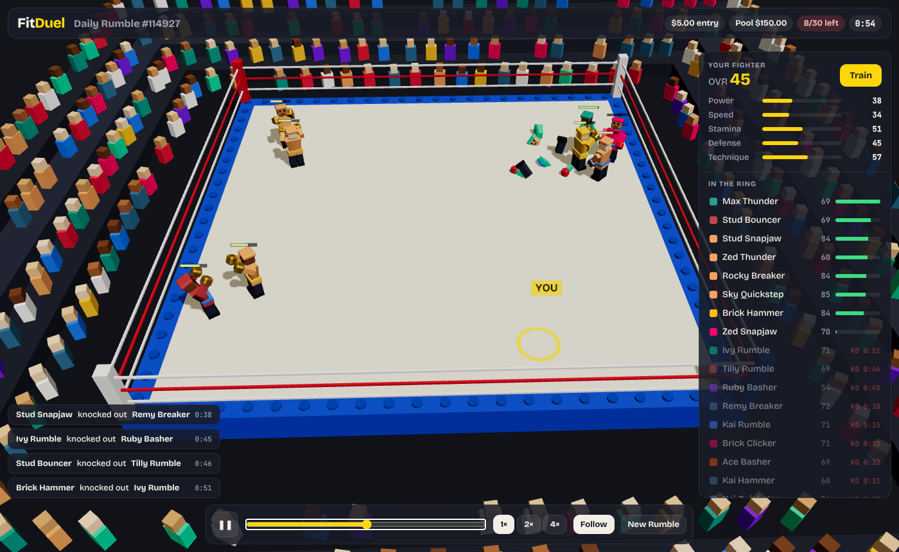
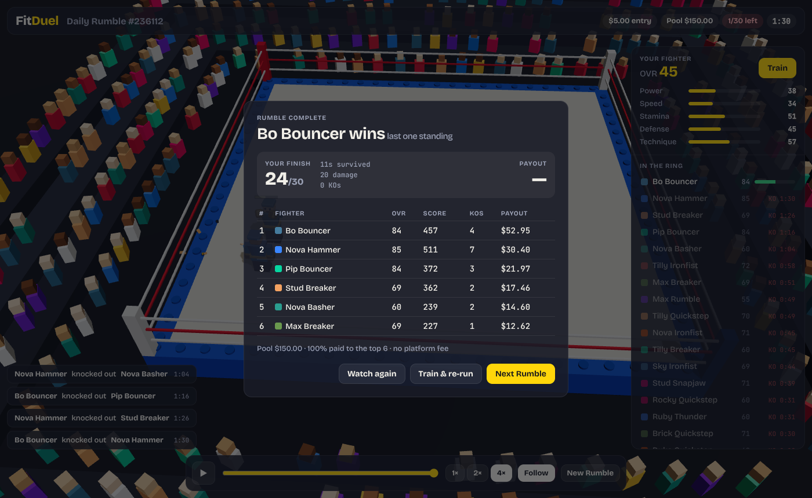
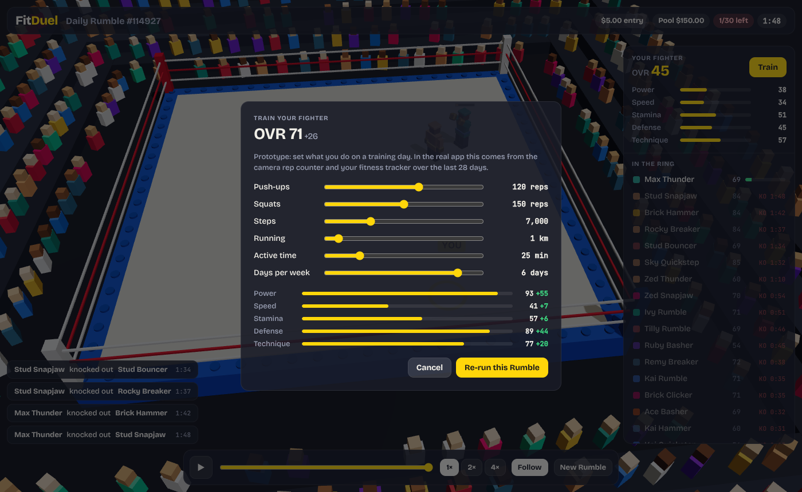
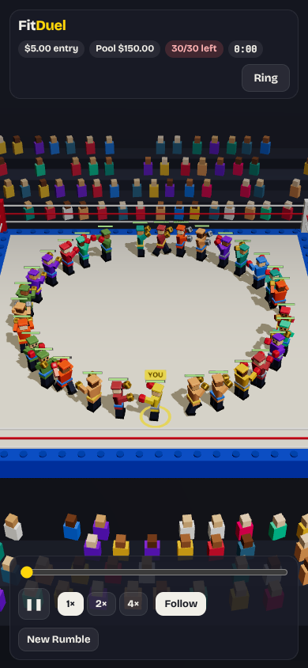

# FitDuel

Train in real life, and your training powers a blocky AI boxer. Enter it into a **Rumble**, a 30-fighter ring match that runs automatically, then watch the 3D replay. The top finishers share the pool.

See [`SPEC.md`](SPEC.md) for the full product spec.



## Phase 0 prototype (this repo)

| Part | What it does |
|---|---|
| `engine/stats.ts` | Turns 28 days of activity (steps, push-ups, squats, running, active time) into fighter stats, with diminishing returns, daily caps and decay |
| `engine/rumble.ts` | Deterministic many-fighter Rumble. Same fighters + seed = same result, so results are verifiable and replays are rebuilt instead of streamed |
| `engine/payout.ts` | Whole pool paid to the top 20%, every paid place wins at least 1.5× the entry, no platform fee |
| `engine/fakeData.ts` | Fake players from training archetypes (couch starter → all-rounder) |
| `web/` | 3D replay viewer: React + Three.js (React Three Fiber), placeholder brick fighters built in code |

The web app uses the same engine code as the server will, so the Rumble you watch is computed by the same rules.

### Run it

Requires Node.js 22.18 or newer.

```bash
npm test                 # engine tests (no install needed)
npm run demo             # print a 30-fighter Rumble with payouts in the terminal

cd web && npm install
npm run dev              # open the printed URL
```

In the viewer:
- You are the yellow fighter marked **YOU**.
- Click any fighter (or a name in the list) to follow them.
- Use **Train** to change your training and re-run the same Rumble, so you can see how training changes the result.

| Results | Train your fighter | Phone |
|---|---|---|
|  |  |  |

## Next (Phase 1 MVP)

- Accounts and a backend that runs scheduled daily Rumbles.
- Camera push-up and squat counter in the browser (MediaPipe Pose).
- Wearable step sync through an aggregator.
- Divisions with skill rating.
- Real Blender character kit replacing the placeholder fighters, using the same parts and pivots.
