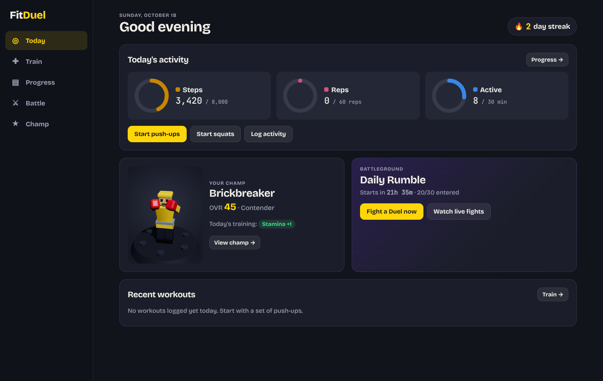
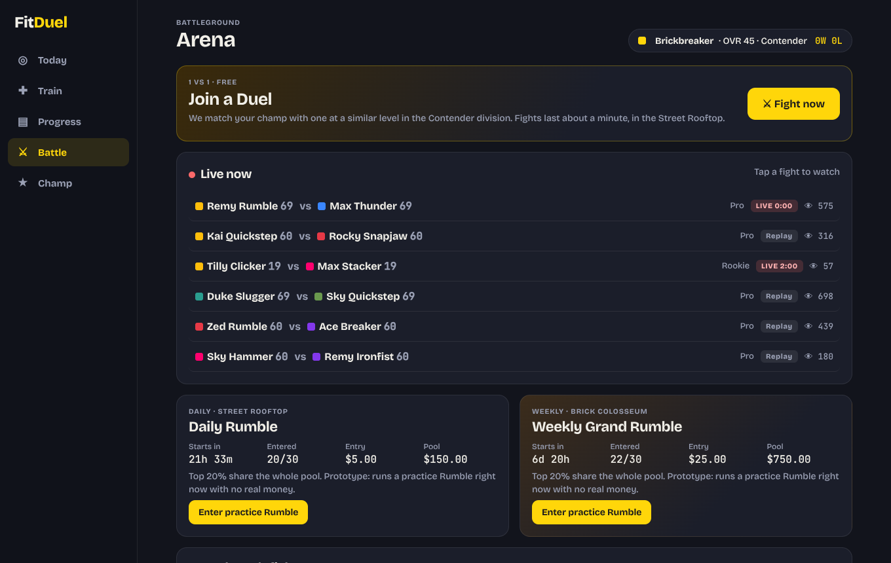
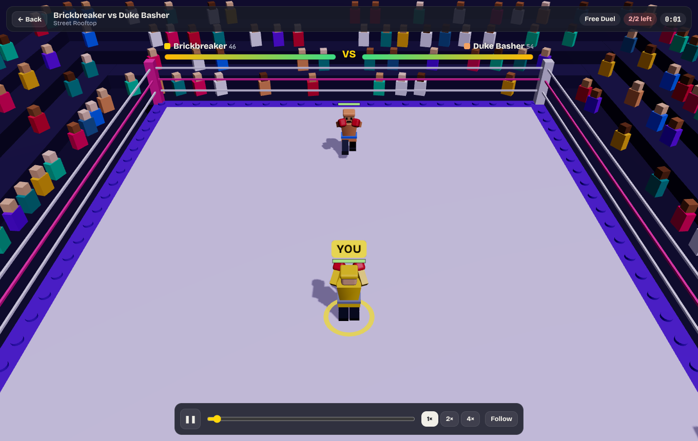
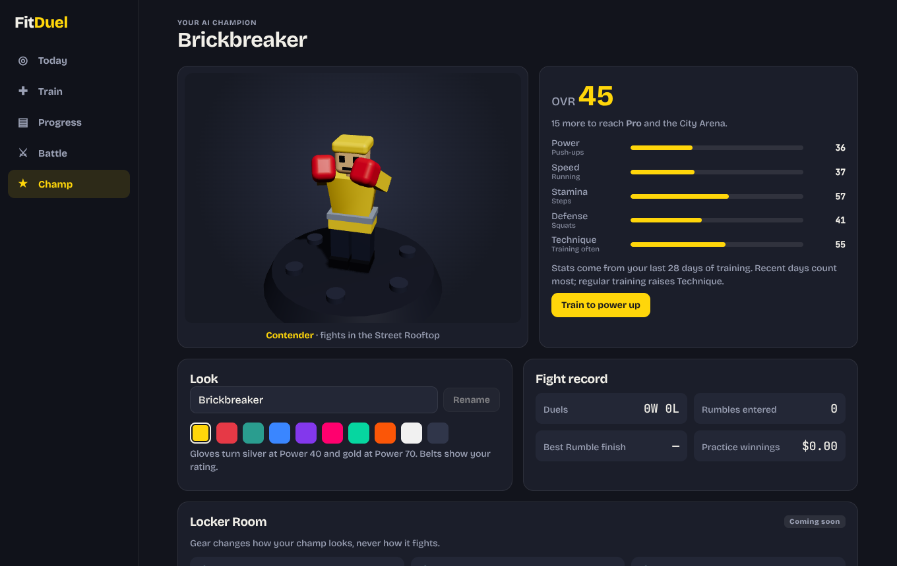
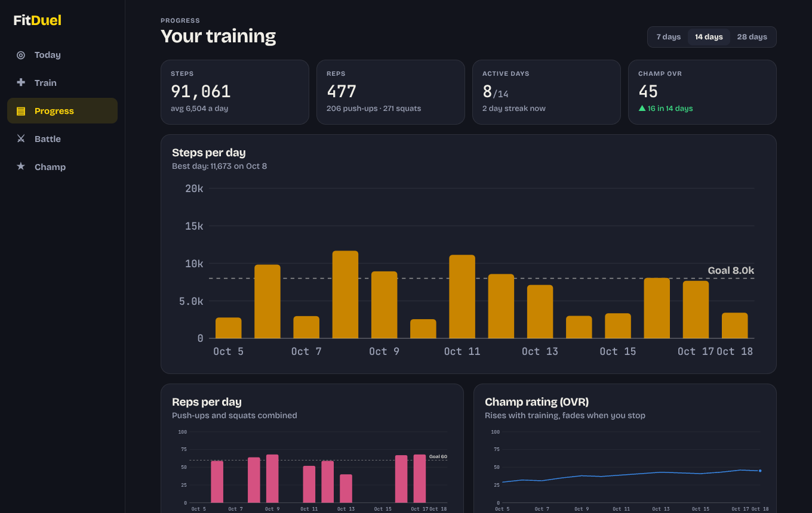
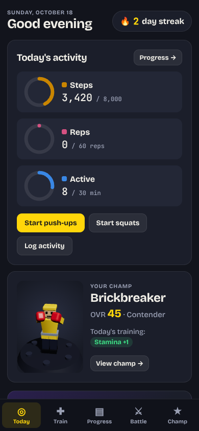

# FitDuel

**A fitness app first.** Track your workouts, steps and progress every day. Your training builds your AI champion, a blocky brick boxer. In the **Battleground** you watch champions fight in Duels and Rumbles, join in, and see your own champ fight.

See [`SPEC.md`](SPEC.md) for the full product spec.



## What's in the app (prototype)

| Tab | What you can do |
|---|---|
| **Today** | Activity rings for steps, reps and active minutes. Streak, quick-start buttons, your champ in 3D with what today's training added, and the next Rumble |
| **Train** | **Camera push-up and squat counter** (pose detection in the browser; the video never leaves the device). Manual logging for steps, runs and active time. Workout history |
| **Progress** | 7/14/28-day charts for steps and reps (with goal lines), your champ's rating over time, totals and personal bests |
| **Battle** | **Join a Duel** (1 vs 1, matched by level), watch **live Duels** of other champions, enter practice **Rumbles** (30 fighters, pool payouts), your fight history |
| **Champ** | Your 3D champion: stats and which exercise builds each one, division progress, name and colour, fight record, Locker Room preview |

Each division fights in its own arena: Garage Gym (Rookie), Street Rooftop (Contender), City Arena (Pro), and Brick Colosseum (Champion and weekly finals).

| Battleground | Duel | Champ |
|---|---|---|
|  |  |  |

| Train | Progress | Phone |
|---|---|---|
|  |  |  |

## How it fits together

| Part | What it does |
|---|---|
| `engine/stats.ts` | Turns 28 days of activity into champion stats, with diminishing returns, daily caps and decay |
| `engine/reps.ts` | Rep counting from pose landmarks. A rep only counts after full range of motion, with a posture check |
| `engine/rumble.ts` | Deterministic fight simulation for Duels (2 fighters) and Rumbles (up to 30). Same fighters + seed = same fight |
| `engine/payout.ts` | Whole pool paid to the top 20%, every paid place wins at least 1.5× the entry, no platform fee |
| `web/` | The app: React, Three.js (React Three Fiber) for 3D, and MediaPipe Pose for the camera counter |

Prototype data (your log, workouts and fights) is stored in the browser only. It starts with a few weeks of sample history; reset it from the Champ tab. Accounts and a backend come next.

## Run it

Requires Node.js 22.18 or newer.

```bash
npm test                 # engine tests: stats, fights, payouts, rep counting
npm run demo             # print a 30-fighter Rumble with payouts in the terminal

cd web && npm install
npm run dev              # open the printed URL
```

The camera counter needs a secure page (`localhost` or HTTPS) and camera permission. To try it on a phone, open the dev server over HTTPS or deploy it.

## Next

- Accounts and a backend: saved training, real scheduled Rumbles, real matchmaking between players.
- Tracker sync for steps and runs (Fitbit, Garmin, Strava through one aggregator).
- More camera exercises.
- The real Blender character kit, replacing the placeholder fighters with the same parts and pivots.
